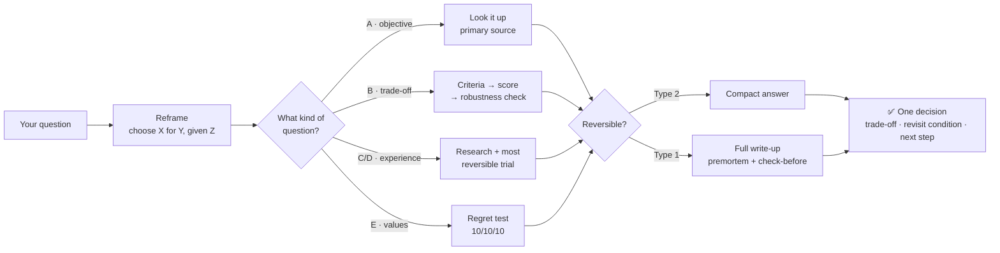

<p align="center">
  <picture>
    <source media="(prefers-color-scheme: dark)" srcset=".github/assets/banner-dark.svg">
    
  </picture>
</p>

<p align="center">
  <a href="https://github.com/stanislav-fedyna-dev/everyday-decisions/releases"></a>
  <a href="https://github.com/stanislav-fedyna-dev/everyday-decisions/actions/workflows/validate.yml"></a>
  <a href="https://agentskills.io"></a>
  <a href="https://skills.sh/stanislav-fedyna-dev/everyday-decisions"></a>
  <a href="LICENSE"></a>
</p>

<p align="center">
  <a href="#install">Install</a> · <a href="#how-it-works">How it works</a> · <a href="#usage">Usage</a> · <a href="skills/everyday-decisions/SKILL.md">Read the skill</a>
</p>

---

**An agent skill that makes everyday decisions for you, and shows its work.**

You ask "X or Y?". Instead of a pros-and-cons list that leaves you where you started, you get **one decision**, the **trade-off** you're accepting, and a **condition for revisiting it**. Then you can stop thinking about it.

Works with Claude (claude.ai, Claude Code, API) and any agent that supports the open [Agent Skills](https://agentskills.io) format.

<!-- DEMO: replace this comment with the demo video (drag the .mp4 into GitHub's editor) -->

```text
You:   Robot vacuum for a 2-bed flat with a cat, mostly laminate, ~400 budget. Just pick one.

Agent: Go with: <Model A> · trade-off · Type 2 (30-day returns)
       Why: Best hair handling in its class (independent test, moderate);
            <price> at <store> today, checked <date>.
       Trade-off: louder than <Model B>.
       Revisit if: it tangles on the cat's hair more than once a week → return within 30 days.
       Next step: <link>
```

## How it works



### Why it works

Most everyday choices don't stall for lack of information. They stall for lack of method. The skill picks the method from the **nature of the question**, not its topic:

| Type | Example | How it's answered |
|---|---|---|
| **A** Objective answer | "Can I fly with this power bank?" | Primary source, current rules. Looked up, not "decided". |
| **B** Trade-off | "Which laptop?" | Must-haves → weighted criteria → check the riskiest assumption |
| **C** "How will I feel", studied | "Commute 40 min or pay more rent?" | Research + your own track record |
| **D** Only knowable by trying | "Will I stick with climbing?" | Best guess + the most reversible way in (rent, trial, returns) |
| **E** Values and taste | "Minimalist or colour tattoo?" | Your priorities, regret test, 10/10/10 |
| **F** Crisis | Health, safety, legal threat now | Out of scope. Points to a professional. |

Then it sets the depth by **reversibility**. A returnable pair of shoes gets a three-line answer. A car, a lease or a tattoo gets a full write-up with a premortem and a "check before you pay/sign" step.

Built-in safeguards:
- Prices, availability and rules are always **searched fresh** in your market, never quoted from memory.
- Every supporting point carries an **evidence level** (`strong` / `moderate` / `consensus` / `weak`).
- It **searches against** its own front-runner before recommending it.
- It always considers **"don't buy / change nothing"** as an option.
- One answer, never "it depends".

## Install

### Claude.ai / Claude desktop app
1. Download `everyday-decisions.zip` from [Releases](https://github.com/stanislav-fedyna-dev/everyday-decisions/releases).
2. Make sure **Code execution / Create and edit files** is on in **Settings → Capabilities**.
3. Go to **Customize → Skills** → **+** → **Create skill** → **Upload a skill**, select the zip, and toggle it on.

### Claude Code
```bash
/plugin marketplace add stanislav-fedyna-dev/everyday-decisions
/plugin install everyday-decisions@everyday-decisions
```

### Any agent (Cursor, Codex, Gemini CLI, Copilot, OpenCode, …)
Using the open [`skills`](https://github.com/vercel-labs/skills) CLI:
```bash
npx skills add stanislav-fedyna-dev/everyday-decisions
```

### Manually
Copy `skills/everyday-decisions/` into your agent's skills folder, e.g. `~/.claude/skills/everyday-decisions/`.

## Usage

It triggers on its own when you're choosing: "help me choose", "which should I get", "X or Y?", "I can't decide", "just tell me what to buy". Any language works; the answer comes back in yours.

Options:

| Add to your message | Effect |
|---|---|
| *(nothing)* | One question, full or compact answer depending on stakes |
| "just tell me" | Compact three-line answer |
| `--one` | Several questions, answered one at a time, stopping after each |
| `--all` | Several questions in a row, ending with a summary table |

Pairs well with a stress-test / devil's-advocate skill: use this one to decide, the other to attack a big decision before you commit.

## What it won't do

- Replace a doctor, lawyer or financial adviser. In those zones it still decides, but marks one step as **"check before <step>"**. Money-related answers are information for your decision, not financial advice.
- Handle emergencies or relationship conflicts. Those aren't choices between options.

## Repository layout

```text
.
├── .claude-plugin/
│   ├── plugin.json            # Claude Code plugin manifest
│   ├── icon.png               # listing icon (1024×1024)
│   └── marketplace.json       # lets this repo act as its own marketplace
├── skills/
│   └── everyday-decisions/
│       ├── SKILL.md           # the skill (frontmatter + instructions)
│       ├── LICENSE.txt
│       ├── references/
│       │   └── worked-examples.md   # loaded on demand
│       └── evals/
│           ├── evals.json           # output-quality test cases
│           └── trigger-queries.json # should / shouldn't trigger
├── scripts/
│   ├── validate.py            # spec checks (also runs in CI)
│   ├── make_banner.py         # regenerates the animated banners
├── .github/                   # CI, release workflow, issue template, README assets
├── CHANGELOG.md
├── LICENSE
└── README.md
```

## Testing

```bash
python scripts/validate.py   # frontmatter and file checks per the Agent Skills spec
```

Behaviour tests live in `skills/everyday-decisions/evals/`: `evals.json` (output quality, with assertions) and `trigger-queries.json` (should / shouldn't activate). Run each prompt with and without the skill and compare, as described in [Evaluating skills](https://agentskills.io/skill-creation/evaluating-skills).

## Contributing

Found a choice where it gave a weak answer? Open an issue with the prompt and the output. Good additions go into `evals/` first, then into `SKILL.md`.

## License

[MIT](LICENSE)
